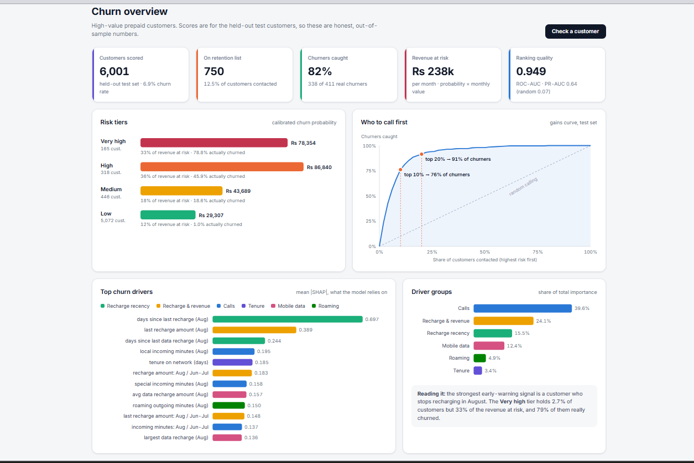
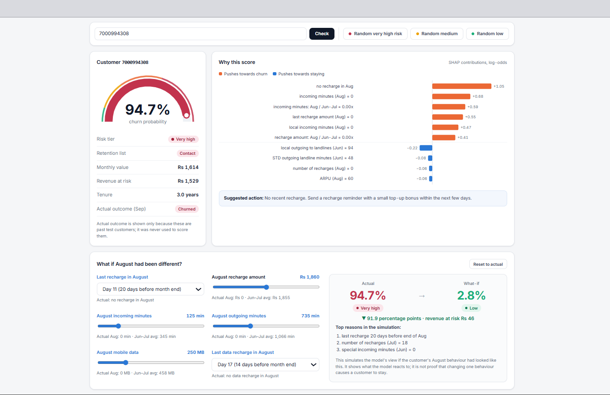
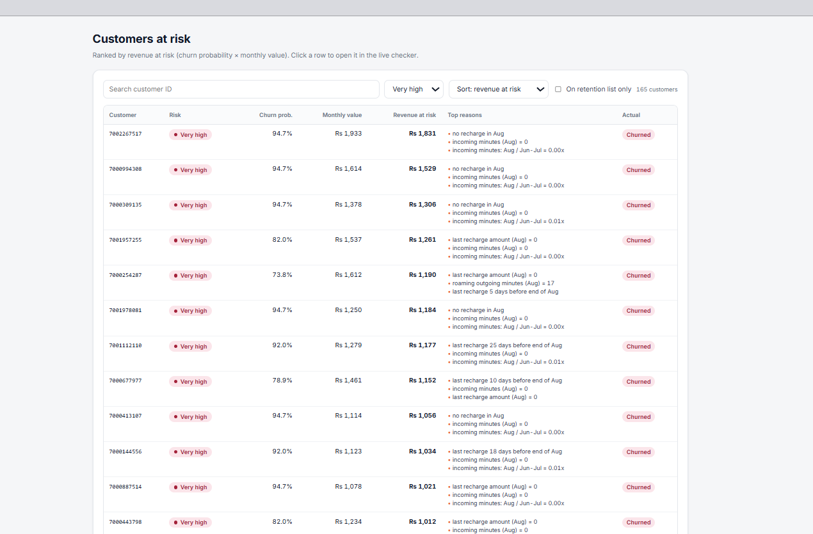

# Telecom Customer Churn Prediction

## Overview

**Churn Radar** predicts which high-value prepaid telecom customers will leave next month, using their June, July and August usage and recharge behaviour.
It is built on the Kaggle telecom churn dataset (99,999 customers, 226 columns, 4 months) and focuses on the 30,001 most valuable customers.
The pipeline covers cleaning, EDA, feature engineering, model comparison, tuning, calibration, SHAP explanations and a time-based robustness check.
The trained model powers a live dashboard where a retention team can check any customer, see why they are at risk and test what-if scenarios.

## Aim

- Predict churn one month ahead, early enough for the retention team to act.
- Rank customers by revenue at risk, so the most valuable customers are contacted first.
- Explain every prediction in plain words, so the team knows what offer to make.
- Keep the evaluation honest: no data leakage and a test set used only once.

## Problem Statement

Prepaid customers have no contract to cancel. A profitable customer simply stops recharging and disappears, and the company only notices after the revenue is gone. Only 6.86% of high-value customers churn, so a model that predicts "nobody leaves" is already 93% accurate and completely useless. The business needs a model that finds the few customers who are about to leave, tells how much revenue each one carries, and does it at a cost the retention budget can afford.

## Key Features

- **Leak-free pipeline:** the data is split before any analysis, and September (the answer month) never reaches the model.
- **Behaviour-change features:** each customer's August is compared with their own June-July habits, which lifted PR-AUC from 0.656 to 0.684.
- **LightGBM with class weights:** chosen over Logistic Regression, Random Forest, XGBoost and SMOTE after a fair 5-fold comparison.
- **Calibrated probabilities:** isotonic calibration makes "70% risk" mean roughly 70 out of 100 customers.
- **Revenue at risk and a profit-based threshold:** customers are ranked by money, and the call list is sized for the best campaign value.
- **SHAP reason codes:** every score comes with its top three reasons, such as "no recharge in Aug".
- **Live dashboard:** overview, live checker with what-if sliders, ranked customer list and CSV batch scoring.

## Architecture Diagram

  

## Dashboard

  
  
  

## Benefits

- **Fewer calls, more customers saved:** calling the top 10% of scores reaches 76% of all churners, compared with 10% for random calling.
- **Budget goes where the money is:** the two highest risk tiers hold Rs 165k of the Rs 238k monthly revenue at risk in just 483 customers.
- **The right offer for each customer:** reason codes show whether the problem is a stopped recharge, falling calls, falling data use or roaming.
- **Positive campaign value:** with illustrative costs, the chosen threshold returns about Rs 98,730 net on the test customers alone.
- **Simple to maintain:** the model holds its accuracy one month later, so a monthly retrain is enough.

## Conclusion

Valuable prepaid customers do not fade away slowly. They recharge normally in June, cut back in July and stop almost completely in August. By comparing each customer's August with their own June-July habits, especially the number of days since their last recharge, the model ranks churners with a ROC-AUC of 0.949, gives honest probabilities and stays accurate a month later. The result is a working product that tells a retention team who to call, how much revenue each call protects and why each customer is at risk.
