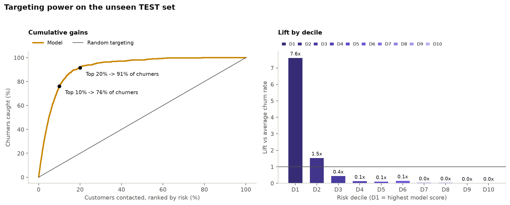
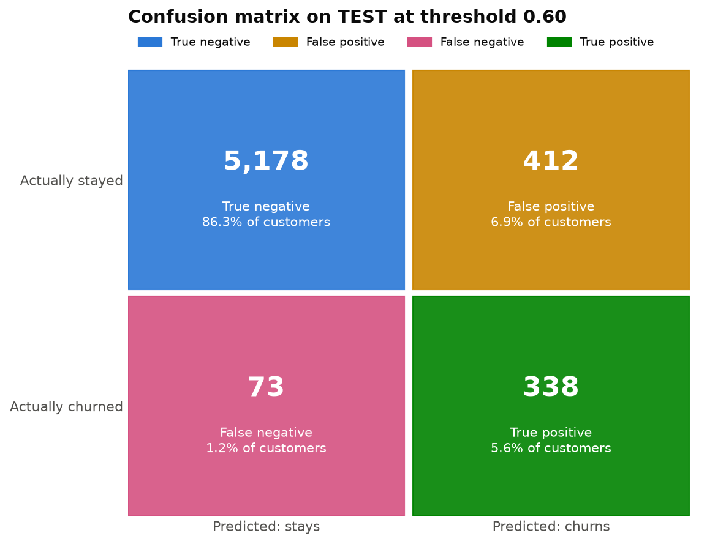
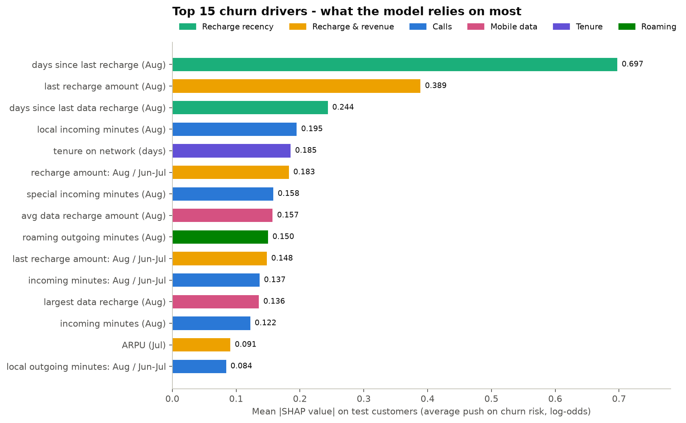
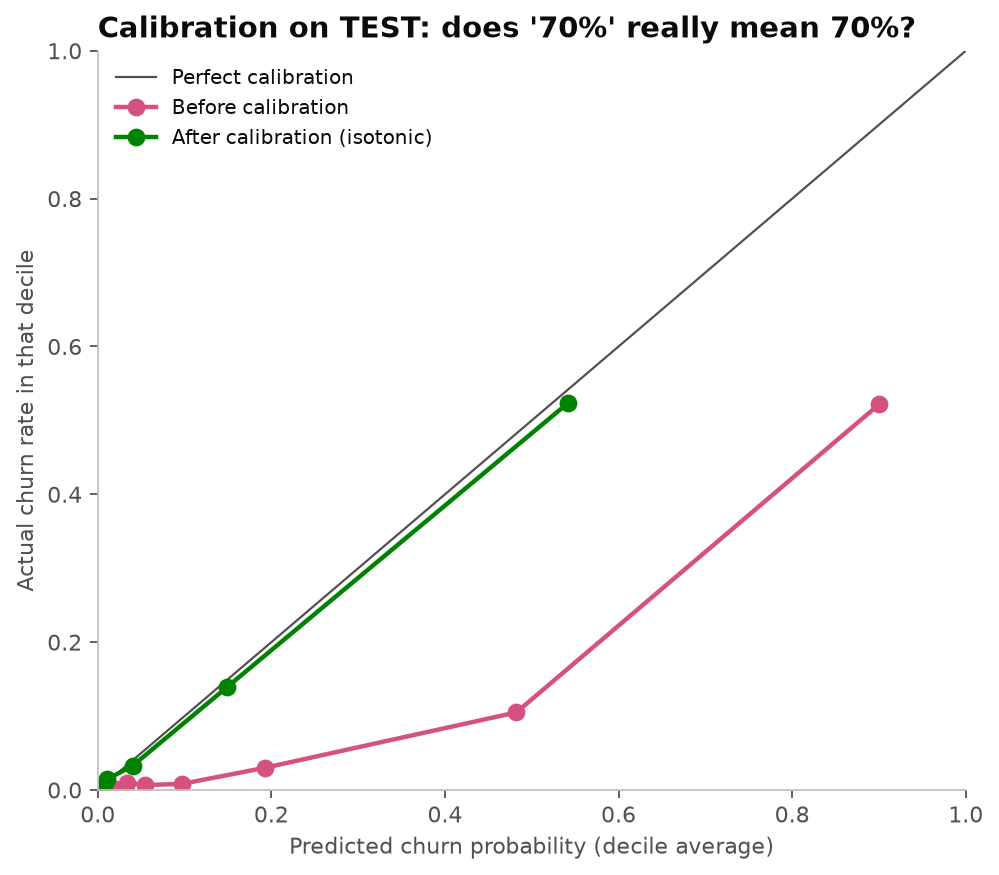
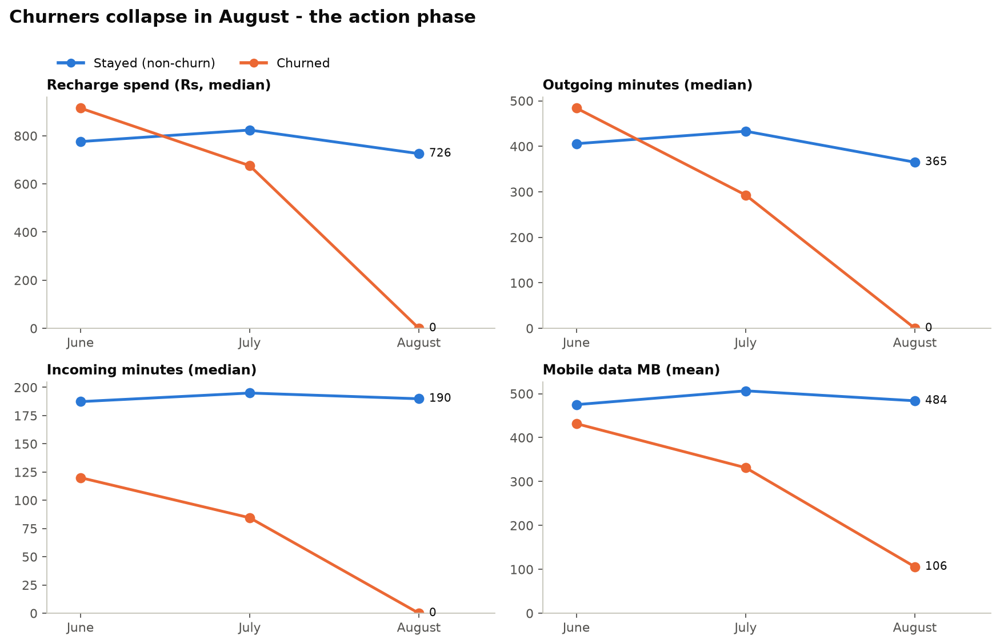
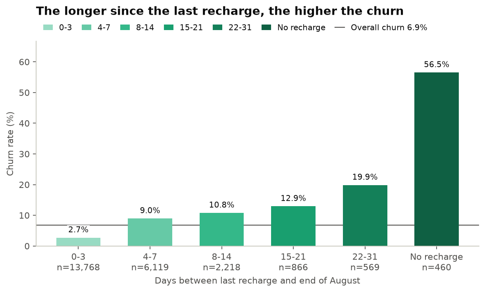
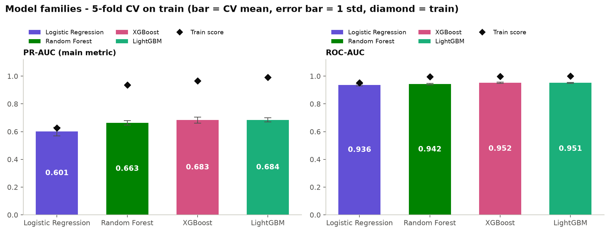
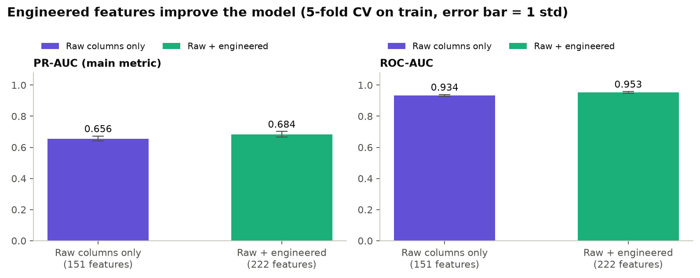
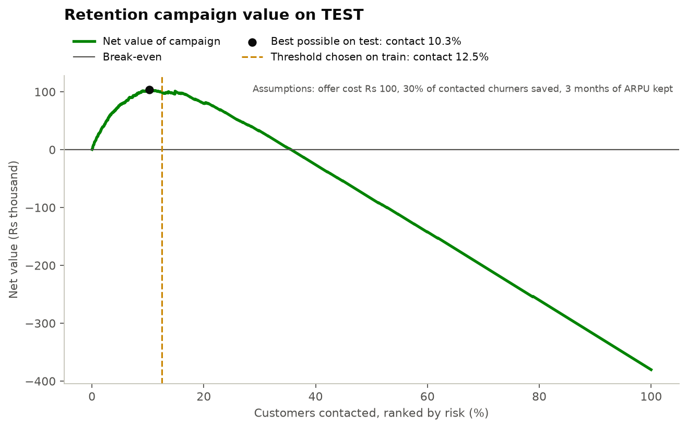
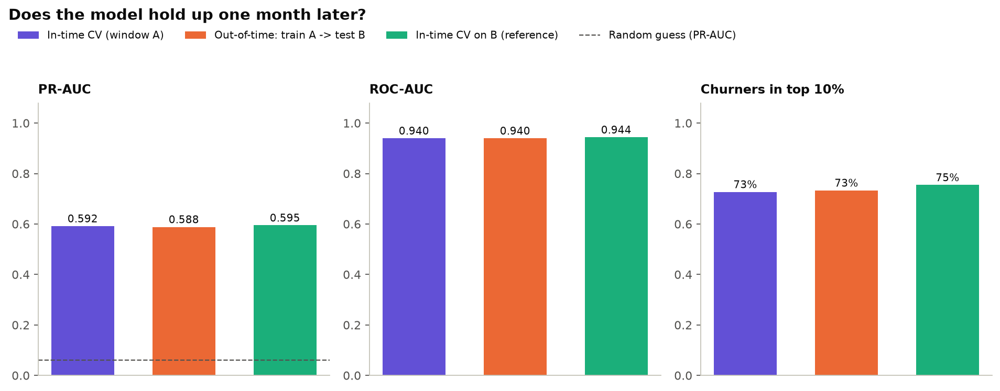

# Churn Radar: Telecom Customer Churn Prediction

**Find the high-value prepaid customers who are about to leave, see why, and know what they are worth before they go.**

---

## Overview

A telecom operator loses money every time a profitable prepaid customer quietly stops recharging. Prepaid customers have no contract to cancel, so they simply disappear.

**Churn Radar** looks at a customer's June, July and August behaviour and predicts whether they will leave in **September**. For every customer it gives:

- a **calibrated churn probability** (a 70% means roughly 70 out of 100 such customers leave),
- a **risk tier** and whether they belong on this month's **retention call list**,
- the **revenue at risk** (probability x monthly value), so the team calls the most valuable customers first,
- the **top reasons** behind the score, in plain words ("no recharge in Aug", "incoming minutes (Aug) = 0").

All of it runs behind a live web dashboard with a customer checker, a what-if simulator and batch CSV scoring.

| | |
| --- | --- |
| **Data** | Kaggle telecom churn dataset (Indian prepaid market, 2014): 99,999 customers x 226 columns, 4 months |
| **Scope** | 30,001 high-value customers (top 30% by June-July spend) |
| **Target** | churn in September: no recharge **and** no usage at all (6.86% of customers) |
| **Model** | LightGBM with class weights, isotonic calibration, SHAP explanations |
| **App** | FastAPI backend + HTML/CSS/JS dashboard, one deployment on Vercel |

## Aim

1. Predict which high-value customers will churn next month, early enough to act.
2. Rank them by **money at risk**, not by probability alone.
3. Explain every prediction so the retention team knows **what offer to make**.
4. Do it honestly: no data leakage, a test set opened once, and numbers in this README that come straight from the code's saved outputs.

## Problem statement

> Given three months of usage, recharge and data activity for a prepaid customer, estimate the probability that the customer stops recharging and stops using the network in the following month, and turn that estimate into a call list the retention team can afford.

What makes it hard:

- **Imbalance:** only 6.86% of high-value customers churn, so accuracy is misleading (predicting "nobody churns" already scores 93%).
- **Leakage traps:** September columns describe the answer; one of them (`sep_vbc_3g`) does not even end in `_9`.
- **Missing values with meaning:** an empty data-recharge field means "never recharged data", not "unknown".
- **Business cost:** a retention call costs money; a lost customer costs far more. The decision threshold has to reflect that.

## Key features

| | Feature | What it means |
| --- | --- | --- |
| &#x1F9EA; | **Leak-free pipeline** | Split first; every cleaning and feature rule works on one customer's own row; September never reaches the model; checks stop the run if anything leaks |
| &#x1F4C8; | **Behaviour-change features** | August compared with each customer's own June-July baseline, days since last recharge, behaviour flags: PR-AUC 0.656 to 0.684 |
| &#x1F3AF; | **Calibrated probabilities** | Isotonic calibration: Brier score 0.071 to 0.036, average prediction 7.1% vs 6.85% actual |
| &#x1F4B0; | **Revenue at risk + profit threshold** | Threshold 0.60 chosen on training data for the best campaign value, not by habit |
| &#x1F50D; | **Explainable** | Exact SHAP values per customer, turned into plain-English reason codes |
| &#x23F1;&#xFE0F; | **Tested over time** | A model trained on July data still works on September (PR-AUC 0.588 vs 0.592) |
| &#x1F5A5;&#xFE0F; | **Live dashboard** | Overview, live checker with what-if sliders, ranked customer list, CSV batch scoring, model card |

## Architecture

The model is trained **offline** once (`src/`, steps 1 to 6). The saved artifacts (`models/`, `app/data/`) are loaded by a FastAPI app that also serves the dashboard, so the whole product is **one Vercel deployment** with no separate backend server. The app computes SHAP values with LightGBM's own `pred_contrib`, which is identical to `shap.TreeExplainer` (checked: difference 0.0), so the deployed app does not need the `shap` package.

## Dashboard

**[&#x25B6; Open the live dashboard](https://YOUR-PROJECT.vercel.app)**

| Page | What you can do |
| --- | --- |
| **Overview** | KPIs, risk tiers with revenue at risk, "who to call first" gains curve, top churn drivers |
| **Live checker** | Enter a customer ID: churn probability, tier, revenue at risk, SHAP "why" chart and a suggested action. Move the **what-if sliders** (August recharge day and amount, calls, data) and watch the risk change |
| **Customers at risk** | 6,001 held-out customers ranked by revenue at risk, with filters and top reasons |
| **Score a file** | Upload customers in the original dataset format and download scored results (sample file provided) |
| **About the model** | Metrics, confusion matrix and the model's limits |

<table>
<tr>
<td width="50%"></td>
<td width="50%"></td>
</tr>
<tr>
<td align="center"><b>Live checker:</b> a 94.7% customer drops to 2.8% if August had looked normal</td>
<td align="center"><b>Customers at risk:</b> ranked by money, with reasons</td>
</tr>
</table>

**Try these IDs** in the live checker (all from the held-out test set):

| Customer ID | What you will see |
| --- | --- |
| `7002267517` | Very high risk (94.7%), churned: no recharge in August |
| `7000136727` | High risk (58.4%), churned |
| `7001040207` | Medium risk (29.5%), churned |
| `7001840261` | Most loyal customer (0.0%), stayed |
| `7000460397` | An honest miss: scored 17.8%, but churned |

## Results

### Test set (6,001 customers, never used for any choice)

| Metric | Value |
| --- | --- |
| ROC-AUC | **0.949** (95% CI 0.939-0.959) |
| PR-AUC | **0.644** (95% CI 0.593-0.695); random guessing = 0.068 |
| Churners caught at threshold 0.60 | **82%** (338 of 411) |
| Precision at threshold 0.60 | 45% (750 customers contacted) |
| Churners in the top 10% / 20% of scores | **76%** / 91% |
| Brier score (calibration) | 0.071 before, 0.036 after |

| Threshold | Precision | Recall | F1 | Accuracy | Customers flagged |
| --- | --- | --- | --- | --- | --- |
| 0.50 (default) | 41.0% | 86.1% | 0.555 | 90.6% | 864 |
| **0.60 (profit-optimal, used)** | **45.1%** | **82.2%** | **0.582** | **91.9%** | **750** |
| 0.81 (best F1) | 55.7% | 69.3% | 0.618 | 94.1% | 512 |

**No overfitting, no leakage:** train 0.760, cross-validation 0.681, test 0.644 (PR-AUC). The test score is slightly below CV and inside its confidence interval.

| Risk tier | Customers | Actually churned | Revenue at risk / month |
| --- | --- | --- | --- |
| Very high (60%+) | 165 | 78.8% | Rs 78,354 |
| High (30-60%) | 318 | 45.9% | Rs 86,840 |
| Medium (10-30%) | 446 | 18.6% | Rs 43,689 |
| Low (<10%) | 5,072 | 1.0% | Rs 29,307 |

<table>
<tr>
<td width="50%"></td>
<td width="50%"></td>
</tr>
<tr>
<td width="50%"></td>
<td width="50%"></td>
</tr>
</table>

### What drives churn (SHAP)

1. **Days since the last recharge in August**: the strongest signal by far; risk jumps after about 9-10 days.
2. **Size of the last August recharge**: a Rs 0 last recharge pushes risk up.
3. **Days since the last data recharge**: risk rises after about 11 days.
4. **Incoming calls in August**: zero incoming minutes usually means the SIM has been put away.
5. **Tenure**: newer customers leave more often.

### Does it hold up next month?

| | PR-AUC | ROC-AUC | Churners in top 10% |
| --- | --- | --- | --- |
| Trained and validated on July data | 0.592 | 0.940 | 72.7% |
| **Trained on July, tested on September** | **0.588** | **0.940** | **73.3%** |
| Best case (trained on September itself) | 0.595 | 0.944 | 75.5% |

A model one month old loses only 0.007 PR-AUC against the best possible case, so **retraining once a month is enough**.

<b>More charts</b> (EDA, model comparison, profit curve, temporal check)

| | |
| --- | --- |
|  |  |
|  |  |
|  |  |

## Business benefits

- **Call fewer people, save more revenue:** calling the top 10% of scores reaches 76% of all churners, instead of 10% with random calling.
- **Spend where the money is:** ranking by revenue at risk puts Rs 165k of the Rs 238k monthly revenue at risk into the two highest tiers (483 customers).
- **Know what to offer:** reason codes say whether the problem is a stopped recharge, collapsing calls, falling data use or roaming, so the offer can match.
- **Positive campaign value:** with illustrative costs (Rs 100 per offer, 30% of contacted churners saved, 3 months of revenue kept) the 0.60 threshold returns about Rs 98,730 net on the test customers alone. Replace these assumptions with the company's own numbers.
- **Trustworthy:** calibrated probabilities, honest test numbers, a model card and a documented miss rate let managers decide how far to trust it.

## Conclusion

Churn in this market is not a slow fade: valuable customers recharge normally in June, cut back in July and **stop almost completely in August**. Comparing each customer's August with their own June-July habits, and especially counting the days since their last recharge, turns that pattern into a model that ranks churners well (ROC-AUC 0.949), gives honest probabilities, and holds up a month later.

The result is a working product rather than a notebook: a retention team can open the dashboard, see who to call, how much revenue each call protects and why each customer is at risk, then score next month's file with one upload.

---

Built by **[@AhmadShahzad357-beep](https://github.com/AhmadShahzad357-beep)** &#xB7; Data: Kaggle telecom churn dataset

